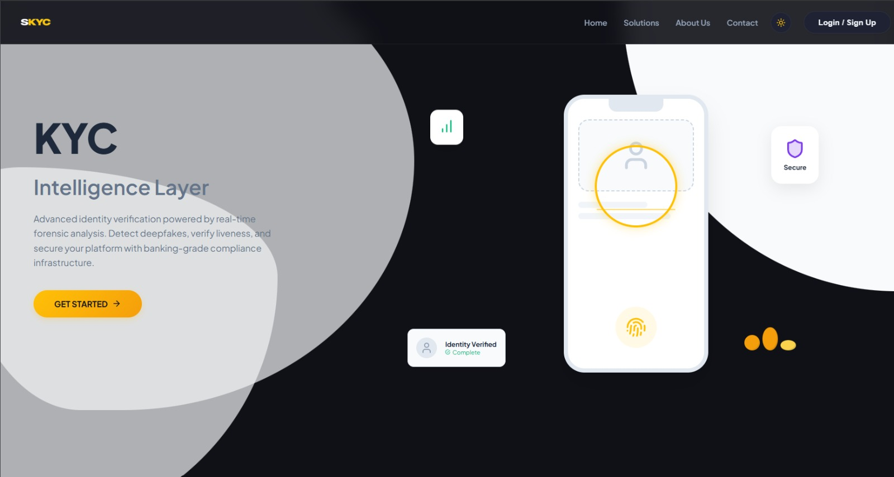
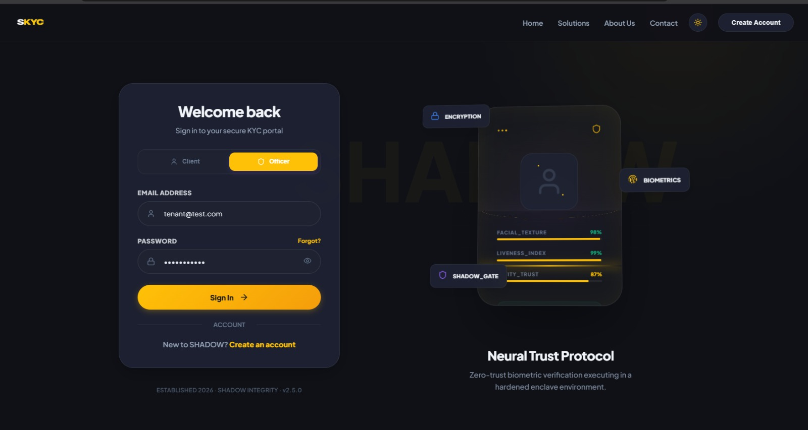
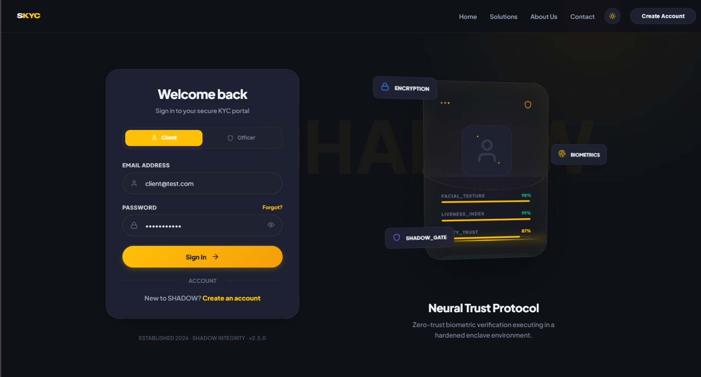
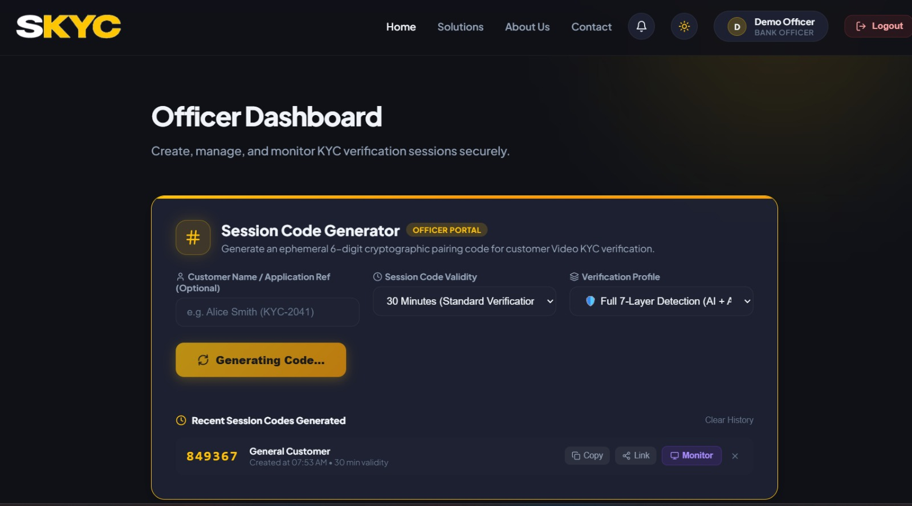
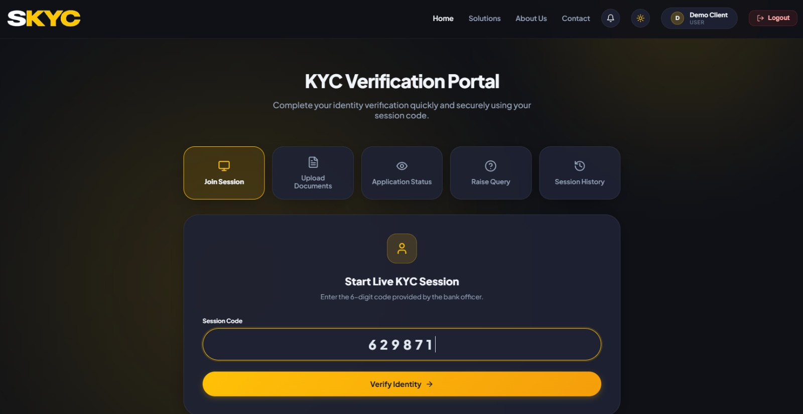
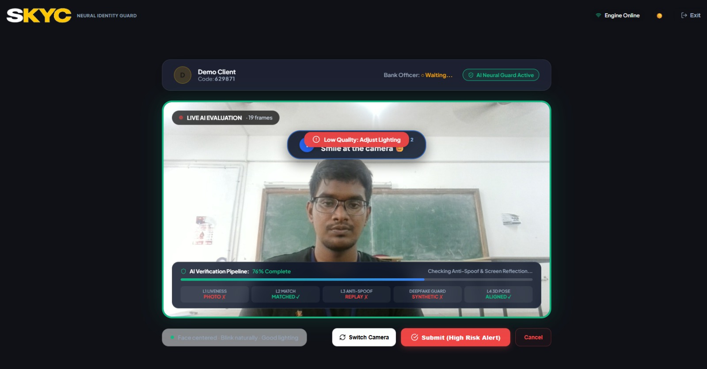
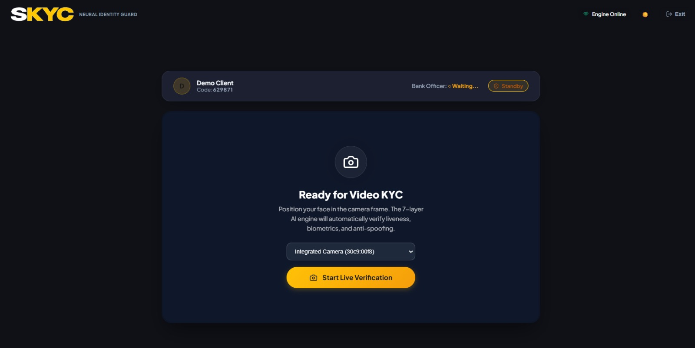
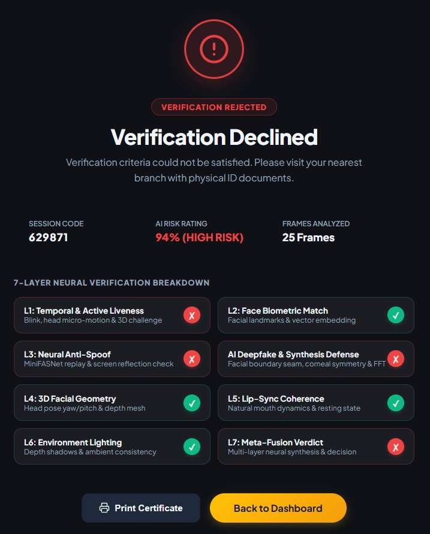

# Shadow-KYC
### AI-Powered Video KYC Verification System

<p align="center">
  <strong>A multi-layer video verification platform designed to identify suspicious activity during digital identity verification.</strong>
</p>

<p align="center">
  
</p>

---

## Overview

Shadow-KYC is an AI-assisted video Know Your Customer (KYC) verification platform designed to strengthen digital identity verification.

Traditional video KYC systems may be vulnerable to identity spoofing, replay attacks, manipulated video feeds, and deepfake-based impersonation. Shadow-KYC addresses these risks through a layered verification pipeline that analyzes facial behavior, temporal consistency, visual artifacts, lip synchronization, and environmental signals.

The system combines these analysis results through a meta-fusion engine to generate an explainable risk assessment.

## Key Features

- **Multi-layer verification:** Seven specialized analysis layers evaluate different aspects of a video session.
- **Temporal liveness analysis:** Examines facial and movement patterns across video frames.
- **Face matching:** Evaluates facial identity consistency.
- **Deepfake artifact analysis:** Checks for visual irregularities and manipulation indicators.
- **Lip synchronization:** Analyzes synchronization between mouth movement and audio.
- **Environment analysis:** Evaluates environmental consistency.
- **Meta-fusion engine:** Combines available layer results into a consolidated risk assessment.
- **Live verification workflow:** Supports real-time communication through WebSockets.
- **Role-based interfaces:** Separate workflows for officers and clients.
- **Evidence and reporting:** Supports verification evidence management and report generation.

---

## Application Screenshots

### 1. Landing Page

The main entry point to the Shadow-KYC platform.


### 2. Authentication

**Officer Login**



**Client Login**



### 3. Officer Dashboard

The officer interface provides access to verification sessions and related KYC activities.



### 4. Client Dashboard

The client interface allows users to participate in verification sessions and access their KYC-related activities.



### 5. Live KYC Verification

The live verification interface supports video-based identity checks and analysis.



### 6. Camera Setup

The camera setup interface allows users to configure their camera before starting verification.



### 7. Verification Results

The result interface displays the verification outcome and available analysis information.



---

## System Architecture

Shadow-KYC uses a seven-layer analysis pipeline coordinated by a session orchestrator.

```text
             Video Input
                  |
                  v
          Session Orchestrator
                  |
        +---------+---------+
        |                   |
        v                   v
   Frame Processing   Challenge Manager
        |
        v
  +-----------------------+
  |  Seven-Layer Analysis |
  +-----------------------+
        |
        +--> L1: Temporal Liveness
        |
        +--> L2: Face Matching
        |
        +--> L3: Texture & Artifact Analysis
        |
        +--> L4: Facial Geometry
        |
        +--> L5: Lip Synchronization
        |
        +--> L6: Environment Analysis
        |
        +--> L7: Meta-Fusion
                  |
                  v
          Risk Assessment
                  |
                  v
        Verification Result
                  |
                  v
          Evidence & Report
```

## Seven-Layer Verification Pipeline

| Layer | Component | Purpose |
|---|---|---|
| L1 | Temporal Liveness | Analyzes facial movement and temporal consistency. |
| L2 | Face Matching | Evaluates facial identity consistency. |
| L3 | Texture & Artifact Analysis | Identifies suspicious visual artifacts. |
| L4 | Facial Geometry | Examines facial proportions and geometric consistency. |
| L5 | Lip Synchronization | Analyzes synchronization between lip movement and audio. |
| L6 | Environment Analysis | Examines environmental consistency and suspicious changes. |
| L7 | Meta-Fusion | Combines analysis signals to produce a consolidated risk assessment. |

### Meta-Fusion Engine

The meta-fusion engine combines the outputs of the verification layers using weighted scoring.

| Analysis Layer | Weight |
|---|---:|
| L1 – Temporal Liveness | 0.25 |
| L2 – Face Matching | 0.20 |
| L3 – Texture & Artifact Analysis | 0.25 |
| L4 – Facial Geometry | 0.10 |
| L5 – Lip Synchronization | 0.10 |
| L6 – Environment Analysis | 0.10 |

The fusion process includes:

- Dynamic normalization based on available analysis layers.
- Contradiction detection between different layer outputs.
- Critical spoof and risk veto rules.
- Consideration of active liveness challenges.
- Consolidation of layer outputs into a frame-level risk assessment.

The frame-level meta-fusion thresholds include:

| Risk Level | Threshold |
|---|---:|
| Medium | 0.30 |
| High | 0.60 |

These are frame-level thresholds; session-level decisions may apply additional orchestration rules.

---

## Technology Stack

### Backend

- Python 3.13
- FastAPI
- Uvicorn
- OpenCV
- MediaPipe
- NumPy
- SciPy
- Pillow
- WebSockets
- Python-JOSE
- Argon2

### Frontend

- React 18
- Vite
- JavaScript
- HTML5
- CSS3
- React Router
- Chart.js
- Lucide React

### Communication and Processing

- REST API
- WebSocket communication
- Video frame processing
- Layer-based analysis
- Session orchestration

---

## Project Structure

```text
Shadow-KYC/
│
├── app/
│   ├── main.py
│   ├── core/
│   │   ├── orchestrator.py
│   │   ├── challenge_manager.py
│   │   ├── deepfake_detector.py
│   │   ├── evidence_manager.py
│   │   └── report_generator.py
│   │
│   ├── layer_1_temporal_liveness.py
│   ├── layer_2_face_match.py
│   ├── layer_3_texture_artifact.py
│   ├── layer_4_geometry.py
│   ├── layer_5_lipsync.py
│   ├── layer_6_environment.py
│   └── layer_7_meta_fusion.py
│
├── frontend/
│   ├── src/
│   ├── public/
│   ├── package.json
│   └── vite.config.js
│
├── tests/
│
├── screenshots/
│   ├── 01-landing-page.jpeg
│   ├── 02-officer-login.jpeg
│   ├── 03-client-login.jpeg
│   ├── 04-officer-dashboard.jpeg
│   ├── 05-client-dashboard.jpeg
│   ├── 06-live-verification.jpeg
│   ├── 07-camera-setup.jpeg
│   └── 08-verification-result.jpeg
│
├── requirements.txt
├── .env.example
└── README.md
```

*The structure above illustrates the main application components. Refer to the repository for the complete directory structure.*

---

## Installation and Setup

### Prerequisites

Make sure the following are installed:

- Python 3.13
- Node.js and npm
- Git

### 1. Clone the Repository

```bash
git clone https://github.com/Gowsh7k/Shadow-KYC.git
cd Shadow-KYC
```

### 2. Backend Setup

Create and activate a virtual environment.

**Windows PowerShell**

```powershell
python -m venv venv
.\venv\Scripts\Activate.ps1
```

Install the dependencies:

```powershell
pip install -r requirements.txt
```

Configure the environment variables using `.env.example` as a reference. Set the required secret key and other configuration values before running the application.

Start the backend:

```powershell
python -m uvicorn app.main:app --host 127.0.0.1 --port 8000
```

The backend will be available at:

```text
http://127.0.0.1:8000
```

### 3. Frontend Setup

Open another terminal and navigate to the frontend directory:

```powershell
cd frontend
npm install
npm run dev
```

Open the local development URL printed by Vite in your browser.

---

## API Documentation

The backend exposes REST API endpoints and WebSocket communication for verification workflows.

| Endpoint | Purpose |
|---|---|
| `/health` | Health check |
| `/ping` | Connectivity check |
| `/auth/signup` | User registration |
| `/auth/login` | User authentication |
| `/auth/logout` | User logout |
| `/session/create` | Create a verification session |
| `/analyze-session` | Analyze a verification session |
| `/upload-recording` | Upload a recording |
| `/ws/session/{session_id}/{role}` | Session WebSocket communication |

Additional KYC, document, verification, decision, query, and audit routes are available in the backend.

Interactive API documentation:

```text
http://127.0.0.1:8000/docs
```

---

## Running Tests

Run the backend test suite from the repository root:

```powershell
python -m pytest tests/ -v
```

---

## Security and Privacy Considerations

- Authentication and token-based access are supported.
- Password handling uses Argon2.
- Environment secrets should be stored in environment variables.
- Do not commit `.env` files, credentials, private keys, or sensitive KYC records.
- Access to identity documents and verification evidence should be restricted.
- Production deployment should include appropriate HTTPS, access controls, logging, and data-retention policies.

## Limitations

Shadow-KYC is a development project and its analysis results should be treated as risk indicators rather than definitive proof of identity or fraud.

- Model performance depends on input video quality and environmental conditions.
- Some analysis layers may be unavailable for certain sessions.
- Risk scores do not guarantee the detection of every spoofing or deepfake attempt.
- Production use requires further validation, security testing, and compliance review.

The platform should not be used as the sole basis for financial, identity, or regulatory decisions without appropriate human review.

---

## Future Enhancements

- Improve model accuracy and robustness across different environments.
- Expand testing with diverse real-world and spoofed video samples.
- Improve verification explainability and evidence visualization.
- Strengthen production authentication and access control.
- Optimize real-time processing performance.
- Extend audit and reporting capabilities.

---

## License

Add the applicable license information before distributing or reusing this project. No license is assumed by this README.

---

<p align="center">
  <strong>Shadow-KYC</strong><br/>
  AI-Assisted Video Identity Verification
</p>